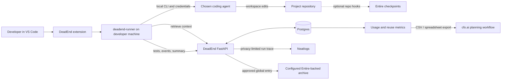

<div align="center">

# DeadEnd

### The memory and verification agent around your coding agents.

DeadEnd gives coding agents access to a team's past failures and fixes, then
shows what happened when they use that context. Keep using OpenCode, Claude
Code, Codex, Pi, Antigravity, or Copilot CLI. DeadEnd adds the memory loop
around them.

**Retrieve before the run. Inject useful context. Test the result. Keep a trace.**

[Demo guide](deadend-demo-workspace/demo_tasks.md) ·
[Video script](DEMO_VIDEO_SCRIPT.md) ·
[Supported agents](SUPPORT.md) ·
[Backend setup](deadend_backend/README.md)

</div>

---

## Why DeadEnd

Coding agents are good at making changes. Teams still lose time when each run
starts without the lessons from previous debugging: which approach failed,
what constraint mattered, and which fix passed verification.

DeadEnd is an **agent around agents**. It retrieves relevant team memories
before a task, runs the coding CLI you choose on your machine, checks the
result, and records run activity. A private memory stays with its team. A
verified fix can be reviewed and explicitly approved for global sharing.



## How a run works

```mermaid
sequenceDiagram
    actor You
    participant UI as VS Code / Web
    participant Runner as Local runner
    participant Agent as Your coding agent
    participant API as DeadEnd backend
    participant Store as Team memory store

    You->>UI: Choose agent, task, memory scope
    UI->>Runner: Start local run
    Runner->>API: Retrieve matching memories
    API->>Store: Match signature and relevant terms
    Store-->>API: Private team + allowed global entries
    API-->>Runner: Ranked, budgeted context pack
    Runner->>Agent: Task + injected failures, constraints, fixes
    Agent->>Runner: Stream response and workspace changes
    Runner->>Runner: Run configured tests; retry once if they fail
    Runner->>API: Record retrieve, inject, attempt, test, verify, result
    API-->>UI: Live run events and dashboard history
```

1. **Choose the agent and scope.** The extension detects installed agent
   CLIs. Your provider login stays with that CLI on your machine.
2. **Retrieve relevant context.** DeadEnd searches exact signatures and
   lexical overlap, applies the environment and team-scope filters, and caps
   the context pack to the configured token budget.
3. **Inject before execution.** The runner adds a managed context block to
   the agent's instruction file and passes the memory pack with the task.
4. **Watch the run.** The extension streams retrieval, injection, agent,
   test, verification, retry, and recording events as they happen.
5. **Verify and record.** The runner executes the configured test command. It
   can make one repair attempt after failed verification, then records the
   final status and telemetry the agent actually reported.
6. **Reuse or curate.** Successful reuse can update memory confidence. Saving
   a failed run creates a private candidate when the trace contains a usable
   failure. A memory is never globally published without a verified fix and
   explicit approval.

## What DeadEnd does

| Capability | What it means in practice |
| --- | --- |
| Team memory | Keep failure signatures, failed approaches, constraints, and fixes in private team scope. |
| Context retrieval | Match exact or related failure text, account for environment, prioritize private team context, and respect a token budget. |
| Local agent runs | Drive the agent CLI already installed and authenticated on the developer's machine. |
| Live activity | Show real retrieve, inject, attempt, test, verify, retry, and record events. |
| Verification | Run the project's test command and give the agent one repair attempt when checks fail. |
| Review before sharing | Redact and preview a verified fix; require a separate user approval before global publication. |
| Run history | Inspect status, project, agent, duration, tokens, memory context, and recorded events in the web dashboard. |
| Economics | Separate measured run/reuse data from user-entered model prices and infrastructure assumptions. |

## Integrations

These systems have distinct jobs. DeadEnd coordinates them; they do not
replace the coding agent.

| Integration | Role in DeadEnd | What to say accurately |
| --- | --- | --- |
| **Neatlogs** | The backend uses the owner's server-side key to emit a compact run trace from selected phases such as retrieve, inject, attempt, test, and verify. Curator and promotion workflows can also be traced. | The run trace is privacy-limited: it excludes source files, terminal output, agent credentials, and the task text. A trace is created at the record phase, so an in-progress run has no final trace yet. |
| **Entire** | Agent-specific repository hooks can capture coding-session checkpoints where enabled. Approved global memories can also be archived in the configured Entire-backed repository. | Checkpoint capture depends on the agent hook, repository setup, and auth. The runner may report no checkpoint ID for a run; don't claim a particular run was checkpointed unless its record shows the ID. |
| **cfo.ai** | The Economics dashboard turns recorded runs and reuse events into measured usage metrics, then exports CSV or spreadsheet data for a business-plan workflow. | Model prices, hosting costs, cash, and growth are explicit assumptions. A published cfo.ai plan URL can be linked in the dashboard; this is an export/link workflow, not an automatic cfo.ai API write. |

## Supported coding agents

| Agent | Local CLI used by the runner |
| --- | --- |
| OpenCode | `opencode run --auto --format json` |
| Claude Code | `claude -p` with JSON output |
| Codex | `codex exec --json` |
| Pi | `pi --mode json` |
| Antigravity CLI | `agy -p` with JSON output |
| Copilot CLI | `copilot --autopilot -p` with JSON output |

Each agent uses its own provider login and plan. DeadEnd detects the CLI; it
does not provide model access or pay the model provider on the user's behalf.
See [SUPPORT.md](SUPPORT.md) for the implementation matrix, exact flags,
MCP configuration, capture support, and known caveats.

## Privacy and trust boundaries

- The agent process and project edits run locally.
- The runner sends the task to the DeadEnd backend for run history and sends
  retrieval, phase, test, and final-summary data needed by the product.
- The backend's Neatlogs trace contains a selected subset of numeric and
  boolean phase fields; it does not include raw task text, source files, or
  terminal output.
- Agent provider credentials are managed by the agent's own CLI and are not
  read or transmitted by DeadEnd.
- The DeadEnd session token is stored in VS Code SecretStorage. Private
  memories are team-scoped. Global sharing requires a verified fix, a review
  preview, and explicit approval.
- Demo seeds are synthetic and marked unverified. They demonstrate retrieval
  and injection; they are not evidence of production incidents or measured
  success.

## Run the demo

The controlled target is [`deadend-demo-workspace/`](deadend-demo-workspace/).
Its API is intentionally small so a demo task can touch several real seams:
the FastAPI routes, the compatibility wrapper, ticket storage, and tests.

1. Deploy the backend version containing the ten demo fixtures.
2. Install the VS Code extension and `deadend-runner`; sign in and choose the
   demo team.
3. Open `deadend-demo-workspace/` and run **DeadEnd: Load demo memories into
   team**. It is safe to repeat; existing entries are skipped.
4. Choose OpenCode, select private team context, and preview the task in
   [`demo_tasks.md`](deadend-demo-workspace/demo_tasks.md).
5. Record the retrieve count, injected item count, test result, repair attempt,
   and final run status. Show a success only if the run actually completed
   successfully.

The memory pack contains synthetic, unverified fixtures. A real run can still
fail or time out; DeadEnd should show that result plainly rather than turn it
into a success claim.

## Development setup

### Runner

```powershell
python -m pip install -e .\deadend-runner
deadend-runner agents
```

### VS Code extension

```powershell
cd extension
npm ci
npm run compile
npm run package
```

The VSIX is written under `extension/dist/`. To use it, install the VSIX from
the VS Code Extensions view.

### Web app

```powershell
cd web
npm ci
npm run dev
```

### Backend

See [backend setup](deadend_backend/README.md) for Supabase, OAuth, Render,
server-side Neatlogs configuration, and the Entire global archive remote.
For local development, configure the `DEADEND_*` environment variables from
[`deadend-backend.env.example`](deadend-backend.env.example) before starting
the FastAPI service.

## Repository map

| Path | Contents |
| --- | --- |
| [`extension/`](extension/) | VS Code UI, sign-in flow, run controls, live timeline, memory browser |
| [`deadend-runner/`](deadend-runner/) | Local Python CLI, agent adapters, retrieval/injection/test/record loop, MCP server |
| [`deadend_backend/`](deadend_backend/) | FastAPI routes, authentication, memory storage, retrieval, run events, economics |
| [`web/`](web/) | Next.js landing page and team dashboard: memories, runs, agents, settings, economics |
| [`deadend-demo-workspace/`](deadend-demo-workspace/) | Ticketdesk target app, synthetic demo task, reproducible tests |
| [`SUPPORT.md`](SUPPORT.md) | Agent and integration support matrix |
| [`DEMO_VIDEO_SCRIPT.md`](DEMO_VIDEO_SCRIPT.md) | Narration and edit cues for the available demo clips |

## Verify changes

```powershell
cd deadend_backend
python -m pytest -q

cd ..\deadend-demo-workspace
python -m pytest -q

cd ..\web
npm run build

cd ..\extension
npm run compile
```

Dashboard metrics are sourced from recorded runs and reuse events. Missing
telemetry stays “no data yet”; estimated cost and business-plan values are
clearly separated from measurements.
