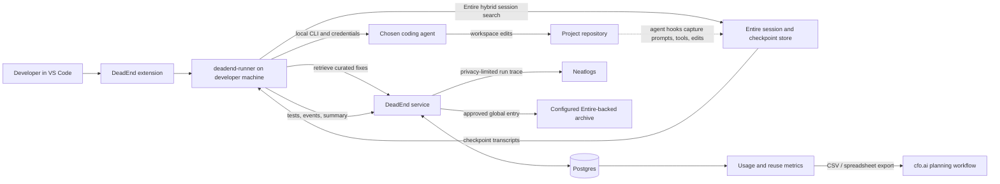
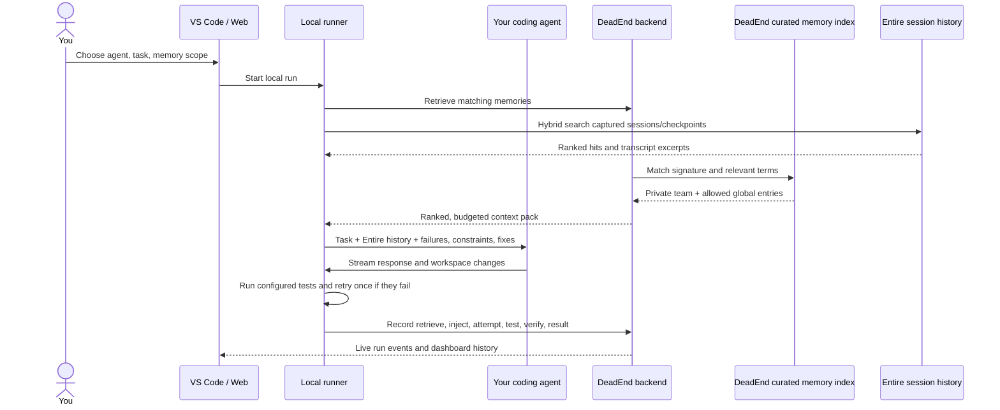

<div align="center">

# DeadEnd

### The memory and verification agent for coding teams.

DeadEnd is an agent that retrieves a team's past debugging work, directs the
coding agent you choose, and verifies the result. It works with OpenCode,
Claude Code, Codex, Pi, Antigravity, or Copilot CLI.

**Retrieve before the run. Inject useful context. Test the result. Keep a trace.**

[Supported agents](SUPPORT.md) ·
[Backend setup](deadend_backend/README.md)

</div>

---

## Why DeadEnd

Coding agents are good at making changes. Teams still lose time when each run
starts without the lessons from previous debugging: which approach failed,
what constraint mattered, and which fix passed verification.

Entire preserves agent sessions and checkpoints in the repository. DeadEnd is
a **team-memory and verification agent** that searches that work history
alongside curated team fixes, runs your chosen coding CLI, checks the result,
and records run activity. Private curated memories stay with their team; a
verified fix can be reviewed and explicitly approved for global sharing.



## How a run works



1. **Choose the agent and scope.** The extension detects installed agent
   CLIs. Your provider login stays with that CLI on your machine.
2. **Retrieve relevant context.** The local runner searches Entire's
   authenticated session/checkpoint index for this repository, then asks the
   DeadEnd service for curated team fixes. Both sources fit within one context
   budget. Entire credentials and raw transcripts stay on the developer's
   machine.
3. **Inject before execution.** The runner adds a managed context block to
   the agent's instruction file and passes the memory pack with the task.
4. **Watch the run.** The extension streams retrieval, injection, agent,
   test, verification, retry, and recording events as they happen.
5. **Verify and record.** The runner executes the configured test command. It
   can make one repair attempt after failed verification, then records the
   final status and telemetry the agent actually reported.
6. **Reuse or curate.** Successful reuse can update memory confidence. Saving
   a failed run creates a private candidate when the trace contains a usable
   failure. A memory is never globally published without a verified fix and
   explicit approval.

## What DeadEnd does

| Capability | What it means in practice |
| --- | --- |
| Team memory | Keep failure signatures, failed approaches, constraints, and fixes in private team scope. |
| Context retrieval | Match exact or related failure text, account for environment, prioritize private team context, and respect a token budget. |
| Local agent runs | Drive the agent CLI already installed and authenticated on the developer's machine. |
| Live activity | Show real retrieve, inject, attempt, test, verify, retry, and record events. |
| Verification | Run the project's test command and give the agent one repair attempt when checks fail. |
| Review before sharing | Redact and preview a verified fix; require a separate user approval before global publication. |
| Run history | Inspect status, project, agent, duration, tokens, memory context, and recorded events in the web dashboard. |
| Economics | Separate measured run/reuse data from user-entered model prices and infrastructure assumptions. |

## How DeadEnd uses its three integrations

DeadEnd is the memory and verification agent coordinating these tools. Each integration has a concrete job in a run:

| Partner | What DeadEnd uses | What the user sees | Boundary to know |
| --- | --- | --- | --- |
| **Entire** | Agent hooks capture sessions and checkpoints in the repository. Before a run, the local runner searches the current repository's Entire history and retrieves relevant transcript excerpts for the selected coding agent. | Earlier agent work can be found and injected beside curated DeadEnd memories; when available, the run links to its new checkpoint. | Search and transcript export run locally under the developer's Entire login. Raw transcripts are not uploaded to DeadEnd. Structured team memories remain in DeadEnd's database; they are not all stored in Entire. |
| **Neatlogs** | The backend records a compact trace of selected run phases, including retrieval, injection, attempts, tests, and verification. Curator and promotion actions can also be traced. | A trace provides an inspectable event record of what happened during a run. | The owner's Neatlogs key stays on the backend. Traces omit raw task text, source files, terminal output, and provider credentials. A final trace is created during recording, so it may not exist while a run is still active. |
| **cfo.ai** | DeadEnd Economics summarizes recorded run and real memory-reuse data and supports CSV/spreadsheet export. A published cfo.ai plan can be linked in the dashboard. | Teams can take measured usage and reuse figures into business planning, then apply their own pricing and cost assumptions. | This is an export and plan-link workflow, not an automatic cfo.ai API integration. Forecast prices and infrastructure costs are assumptions, not measured spend. |

Together: **Entire supplies searchable work history; DeadEnd retrieves, directs, and verifies; Neatlogs records the run; cfo.ai receives planning inputs from measured usage and reuse.**

## Supported coding agents

| Agent | Local CLI used by the runner |
| --- | --- |
| OpenCode | `opencode run --auto --format json` |
| Claude Code | `claude -p` with JSON output |
| Codex | `codex exec --json` |
| Pi | `pi --mode json` |
| Antigravity CLI | `agy -p` with JSON output |
| Copilot CLI | `copilot --autopilot -p` with JSON output |

Each agent uses its own provider login and plan. DeadEnd detects the CLI; it
does not provide model access or pay the model provider on the user's behalf.
See [SUPPORT.md](SUPPORT.md) for the implementation matrix, exact flags,
MCP configuration, capture support, and known caveats.

## Privacy and trust boundaries

- Entire's CLI search and transcript retrieval run locally under the user's Entire login; raw transcripts are injected locally and are not sent to DeadEnd's backend.
- The agent process and project edits run locally.
- The runner sends the task to the DeadEnd backend for run history and sends
  retrieval, phase, test, and final-summary data needed by the product.
- The backend's Neatlogs trace contains a selected subset of numeric and
  boolean phase fields; it does not include raw task text, source files, or
  terminal output.
- Agent provider credentials are managed by the agent's own CLI and are not
  read or transmitted by DeadEnd.
- The DeadEnd session token is stored in VS Code SecretStorage. Private
  memories are team-scoped. Global sharing requires a verified fix, a review
  preview, and explicit approval.

## Development setup

### Runner

```powershell
python -m pip install -e .\deadend-runner
deadend-runner agents
```

### VS Code extension

```powershell
cd extension
npm ci
npm run compile
npm run package
```

The VSIX is written under `extension/dist/`. To use it, install the VSIX from
the VS Code Extensions view.

### Web app

```powershell
cd web
npm ci
npm run dev
```

### Backend

See [backend setup](deadend_backend/README.md) for Supabase, OAuth, Render,
server-side Neatlogs configuration, and the Entire global archive remote.
For local development, configure the `DEADEND_*` environment variables from
[`deadend-backend.env.example`](deadend-backend.env.example) before starting
the FastAPI service.

## Repository map

| Path | Contents |
| --- | --- |
| [`extension/`](extension/) | VS Code UI, sign-in flow, run controls, live timeline, memory browser |
| [`deadend-runner/`](deadend-runner/) | Local Python CLI, agent adapters, retrieval/injection/test/record loop, MCP server |
| [`deadend_backend/`](deadend_backend/) | FastAPI routes, authentication, memory storage, retrieval, run events, economics |
| [`web/`](web/) | Next.js landing page and team dashboard: memories, runs, agents, settings, economics |
| [`SUPPORT.md`](SUPPORT.md) | Agent and integration support matrix |

## Verify changes

```powershell
cd deadend_backend
python -m pytest -q

cd ..\web
npm run build

cd ..\extension
npm run compile
```

Dashboard metrics are sourced from recorded runs and reuse events. Missing
telemetry stays “no data yet”; estimated cost and business-plan values are
clearly separated from measurements.
